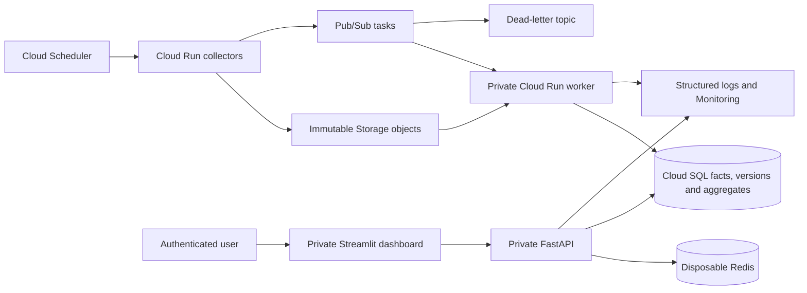

# RidePulse: completed implementation and evaluation

RidePulse now has a working private ingestion pipeline, analytics API, versioned
Redis cache, transactional serving aggregates, Streamlit dashboard, monitoring,
reproducible experiments and an operating runbook. The original **3,860,371 NYC
trip facts are preserved**. All **61 correctness tests passed** using isolated
PostgreSQL/Redis. Shivani approved publication with the reviewed commit message.

The cached API completed **17,342 measured requests with zero errors or result
mismatches**. At 20 users, median trial p95 was **220 ms**, with median successful
throughput **104.92 requests/s**. Worker scaling is workload dependent: eight
workers achieved **1.56× speedup** for the repeated 160,000-row study, while the
larger pilot slowed down with additional workers. The results support bounded
concurrency on this SQL tier, rather than assuming linear scale-out.

## What was completed

| Area | Implemented behavior and verification |
| --- | --- |
| Live data delivery | Collectors archive immutable objects and publish generation-pinned Pub/Sub tasks. Fresh broker-delivered tasks reached SQL after the final resume. |
| Ingestion correctness | Validated CSV/GBFS ingestion, transaction rollback/retry, primary-key deduplication, concurrent duplicate safety and exact incremental aggregate maintenance. |
| API | Read-only SQL transactions; pickup/dropoff rankings, routes, local-time trends, station listings, latest observations and low-availability samples; bounded filters/pagination. |
| Cache | Committed per-city/domain versions, namespace isolation, bounded Redis timeouts, SQL fallback, and freshness recomputed on cache hits. |
| Serving aggregates | Owner migration 010 applied; aggregates rebuilt and reconciled with facts; stale watermarks fall back to facts. |
| Schema isolation | Preserved DB_SCHEMA connection options; tests include warmed Redis entries with equal versions in different SQL schemas. |
| Availability query | Page over station IDs before fetching each newest observation. This resolved the timeout exposed by the larger snapshot history. |
| Dashboard | Real trip charts/tables, station map and freshness indicators, API error states, and explicit unsupported Boulder trip history. |
| Observability | Structured request/task/SQL timing logs, native Monitoring dashboard, retained metrics and cloud reliability evidence. |
| Operations | Explicit university account/project flags, start/stop helpers, generation-pinned replay, CI workflow, demo guide and measured evaluation scripts. |

## Architecture

Collectors write raw Storage objects with an immutable-generation precondition.
The private worker validates each task and stages rows with COPY before committing
facts, versions and aligned aggregate updates together. Retryable infrastructure
failures return failure for redelivery; permanent data rejections are acknowledged
and logged. Acknowledgment alone is not evidence of an insert: outcomes and row
counts distinguish committed, duplicate and rejected work.

The API checks committed SQL versions before using Redis. Cache keys include
database/schema identity, filters and versions. Cache hits remain consistent with
the request's repeatable-read snapshot; later commits appear on the next request.
A paused database is reported unavailable, rather than disguised as fresh cache.

City-local dates use an exclusive end boundary. Dropoffs filter arrival times.
GBFS readings are observations, not reconstructed trips. Low-availability fractions
use known eligible readings and do not invent shortage durations across gaps.

## Data and integrity

Final reconciliation matched **3,860,371** trip facts to hourly totals and both
pickup/dropoff station-hour totals. Route totals matched **3,848,169** facts with
known endpoints. The public trip version and aggregate watermark remained **0**,
with a valid aggregate state, after all isolated worker trials. Versions are change
tokens, not row counts; the existing historical facts were not reimported.

The recent-history replay committed all **4,067 planned objects**, zero rejected,
with 5,237,301 reported row writes across metadata/status tasks. A final current-day
reconciliation committed another **132 planned tasks**, including duplicate-safe
replays, to close the processing pause. Write counts are not unique snapshot counts.

Final SQL observations at 2026-11-15T05:22:00.906539+00:00:

| City | Stored snapshot rows | Earliest collection UTC | Latest collection UTC |
| --- | ---: | --- | --- |
| boulder | 158,264 | 2026-10-22 23:31:31.734689+00 | 2026-11-15 05:20:38.763526+00 |
| nyc | 5,258,078 | 2026-10-22 23:31:31.258666+00 | 2026-11-15 05:20:38.2381+00 |

Stored coverage contains explicit gaps; a first/last timestamp does not establish
continuous collection. Boulder has station availability, not imported trip history.
The isolated benchmark facts were reset to **zero** after measurements. Final
measured database size was approximately 3.31 GiB;
provisioned storage and its billing are separate from this used-size measurement.

## Experimental method

Services ran in `us-central1` in project `ridepulse-dcs-2026`, using the university
identity `shpa6505@colorado.edu`. Runtime image digests and actual revisions are
retained in `experiments/results/environment.json` and worker run records.

The API comparison used matching images, 1 vCPU/512 MiB, concurrency 8, maximum
10 instances and one SQL connection per instance. SQL was the existing shared-core
`db-g1-small` tier, with maximum 50 connections. Redis was Basic 1 GiB. The bypass
service checked the same durable versions and skipped Redis get/set; it did not
receive a different query implementation or stronger resources.

Five fixed April query results—pickups, dropoffs, routes, hourly and daily patterns—
were fingerprinted and compared on every successful response. Locust ran 1/5/10/20
users for 30 seconds, three repeats, alternating mode order. User waits were
0.05–0.15 seconds. Results include the laptop-to-region network path. Cache queries
were warmed; this is not a cold-cache or invalidation-under-load benchmark.

Worker trials used identical immutable inputs, 1 vCPU/512 MiB, concurrency one and
fixed producer concurrency 16. The primary study inserted **160,000 unique source
rows per trial** from sixteen 10,000-row objects derived from pinned original
50,000-row CSVs. Headers, source generations and content hashes are retained. Limits
1/2/4/8 were rotated over three repeats. Every trial started from an empty isolated
schema and verified exact fact/hourly totals; no duplicate-only workload substituted
for insertion. Task intervals and instance IDs establish actual concurrency.

Worker scaling uses authenticated HTTP with normal Pub/Sub envelopes. It measures
worker/SQL/Cloud Run request handling, including startup/retry overhead, **not Pub/Sub
dispatch throughput**. Real broker authentication, retry and dead-letter behavior
were verified separately. Background SQL processing was paused during measurements.

An initial client-interrupted worker attempt with expired-token failures was
excluded. The harness now refreshes tokens, bounds trial dispatch, rejects
suspension-distorted timing and keeps the Mac awake. Four valid 800,000-row pilot
runs are reported separately from the smaller repeated study; no mixed-workload
averages are used.

## API results

| Users | Mode | Requests | Errors | Median successful req/s | Median p50 ms | Median trial p95 ms |
| ---: | --- | ---: | ---: | ---: | ---: | ---: |
| 1 | cached | 551 | 0 | 6.18 | 40 | 120 |
| 1 | bypass | 67 | 0 | 0.83 | 960 | 2700 |
| 5 | cached | 2,575 | 0 | 28.48 | 48 | 160 |
| 5 | bypass | 87 | 24 | 0.73 | 5100 | 6700 |
| 10 | cached | 5,057 | 0 | 56.36 | 57 | 150 |
| 10 | bypass | 191 | 151 | 0.36 | 5100 | 13000 |
| 20 | cached | 9,159 | 0 | 104.92 | 66 | 220 |
| 20 | bypass | 355 | 314 | 0.33 | 5100 | 11000 |

Cached mode had **zero errors, mismatches or version drift**, and all 17,342
responses were cache hits. Bypass mode completed 700 requests, with **489 errors**;
sampled Cloud Logging errors identify SQL pool timeouts. Its higher-load results
show the fallback capacity limit of this one-connection configuration. Successful
responses still matched the fixed-data reference. SQL fallback works functionally,
but this configuration does not sustain the cached service's offered load without
Redis. Error-inclusive p95 must be read alongside the error counts.

Throughput above counts successful requests, rather than treating fast failures as
useful work. Values are medians of trial summaries, not pooled latency percentiles.
Error bars show the min/max over three runs, not confidence intervals. Final Locust
terminal totals were checked against validation counters; periodic CSV snapshots
can precede a few final responses. Locust's printed/bucketed percentiles and
throughput precision are retained. See the
[Locust statistics source](https://docs.locust.io/en/stable/_modules/locust/stats.html).
These short closed-loop trials establish a bounded demonstration, not production
capacity or a universal Redis speedup.

## Worker results

Primary study: **160,000 rows per run; three repeats per setting**.

| Target maximum | Observed peaks across repeats | Median seconds | Median rows/s | Speedup | Efficiency vs target |
| ---: | --- | ---: | ---: | ---: | ---: |
| 1 | [1, 1, 1] | 26.30 | 6,083 | 1.00 | 100.0% |
| 2 | [2, 2, 2] | 18.69 | 8,560 | 1.41 | 70.4% |
| 4 | [4, 4, 4] | 17.66 | 9,062 | 1.49 | 37.2% |
| 8 | [8, 8, 8] | 16.90 | 9,468 | 1.56 | 19.5% |

Eight workers reached eight observed active instances in every repeated run, but
median speedup was only 1.56× and efficiency versus the configured target was
19.5%. Two workers captured most of the measured gain. More instances therefore
increase capability without guaranteeing proportional throughput.

The larger **800,000-row pilot has one run per setting**:

| Target maximum | Observed peak | Seconds | Unique rows/s |
| ---: | ---: | ---: | ---: |
| 1 | 1 | 116.09 | 6,891 |
| 2 | 2 | 307.37 | 2,603 |
| 4 | 5 | 340.49 | 2,350 |
| 8 | 8 | 340.55 | 2,349 |

This pilot shows a different operating regime: additional workers reduced
throughput. Same-city version/aggregate updates serialize inside a transaction,
and the small shared SQL instance is a common resource. The contrast is consistent
with contention and working-set effects, but these experiments do not isolate CPU,
I/O, cache pressure and lock time causally. Available minute-resolution native SQL
telemetry is retained as context; it is not a per-query decomposition.

The pilot observed five active instances at target four. This is consistent with
Cloud Run's documented temporary overshoot during spikes/deployment transitions;
observations were retained rather than clamped to the setting.
[Cloud Run maximum instances](https://docs.cloud.google.com/run/docs/configuring/max-instances).
The pilot is exploratory and is not presented with three-repeat statistics.

## Reliability and final demo

The controlled cloud reliability experiment verified authenticated push, recovery
of the **same broker message** after a database failure, replay and dead-letter
forwarding. Before/after public data comparisons matched, temporary resources were
removed, and the paused production path was restored before live collection.
Local real-database tests additionally cover rollback, commit followed by lost
response, concurrent duplicates, durable invalidation, DST/date boundaries,
schema/cache isolation and aggregate equivalence. **All 61 tests passed**. The
GitHub Actions workflow runs the same isolated suite on pushes and pull requests;
remote execution status is available in the repository Actions tab.

Final resume produced fresh broker-delivered SQL observations at approximately
05:17 UTC November 15 (10:17 p.m. November 14 in Denver). The API returned 198 fresh
readings on a 200-station NYC page and all 76 Boulder stations fresh; the remaining
NYC stale readings stayed visibly flagged. The deployed dashboard rendered the
3,860,371-trip selection, rankings, trends, routes and fresh Boulder observations.
Screenshots accompany the exported report. Native logs/metrics, replay manifests,
raw Locust results and worker interval evidence are retained under
`experiments/results/`.

## Useful improvements after this completed scope

1. **Tune bulk concurrency to workload size.** The larger pilot favors one worker
   on this tier; the smaller study gains most by two. A separate database-tier,
   memory/work-memory and batch-size experiment is more useful than blindly
   raising worker limits. Do not change those settings within a compared run.
2. **Separate service identities and database roles.** Existing scoped act-as
   permissions required reusing the worker identity. Owner-provisioned API and
   dashboard identities plus a dedicated read role would narrow access further.
3. **Profile query/aggregate costs before adding tables.** Current indexed
   availability paging resolves the demonstrated timeout. A maintained latest
   snapshot table or targeted arrival-time index may help a larger deployment,
   but introduces additional migration/maintenance work that should be measured.
4. **Keep optional features proportionate.** Forecasting without held-out
   evaluation or Boulder trip labels adds little to this project. Reimporting all
   already-loaded history wastes work. Generation-pinned archives, replay,
   transactional versions and freshness indicators directly support correctness.
5. **Optional enhanced metrics.** Native Monitoring and structured logs work.
   Creating additional log-based metrics was denied for this identity; reviewable
   definitions remain under `infra/monitoring/`. No further owner action is needed
   to run the completed core project.

## Operating state and handoff

Shutdown was verified at 05:27 UTC November 15 (10:27 p.m. November 14 in Denver):
Cloud SQL is `STOPPED` with policy `NEVER`, Redis is absent, and the three private
Cloud Run deployments have minimum instances zero at both service/revision levels. Task publishing
is disabled and push detached before SQL stops; no queue is purged. Durable SQL
facts, Storage objects and manifests remain. Raw archival collection stays
scheduled, so storage and collector costs can continue. Closing dashboard tabs
also ends active Streamlit websockets.

Verify the completed SQL stop operation and activation policy `NEVER`; the Admin
API may still report state `RUNNABLE` for an owner-stopped instance. This follows
[Google's instance-state definition](https://docs.cloud.google.com/sql/docs/postgres/admin-api/rest/v1beta4/instances).
Final shutdown evidence is retained in `experiments/results/shutdown.json`.

Use **RUNBOOK.md** for university-account authentication, SQL proxy, start/stop,
cache recreation and private dashboard access; **DEMO.md** provides the walkthrough;
**API.md** documents filters/freshness; **EXPERIMENTS.md** gives reproduction commands.
The current billing association was not changed. Shivani approved the commit
message `feat: complete RidePulse analytics, pipeline, and evaluation` and publication
to main. The retained measurements describe the verified implementation before publication.
