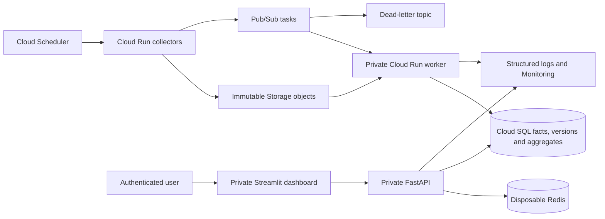
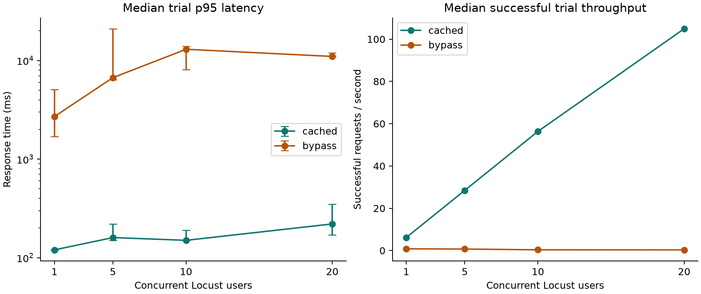
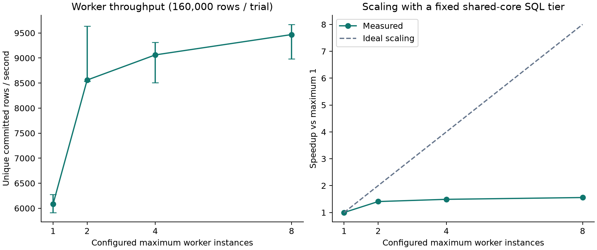

# RidePulse

## Distributed Bike-Share Trip & Station Analytics Service

**CSCI 5253 - Datacenter Scale Computing, Final Project**

**Participants: Harshitha Ravishankar and Shivani Dilipkumar Patel**

Code: https://github.com/harshitharavi26/ridepulse

## Overview and goals

RidePulse serves historical trip patterns and observed bike/dock availability through a dashboard and REST API. NYC provides a real millions-of-rows workload; Boulder BCycle provides a local availability case study. Our systems goals were to preserve correct answers under duplicate task delivery, measure cache impact, and determine whether more workers improve ingestion throughput on a fixed database tier.

The application domain is established rather than a new research invention. Our engineering contribution is the integration of immutable replayable inputs, retry-safe transactional ingestion, durable dataset-version cache invalidation and measured scale-out limits. This is a service we built and evaluated, rather than simply a dashboard over an existing analytics tool. No forecasting model was trained; it was an optional proposal extension, and we prioritized evaluated systems behavior.

RidePulse now has a working private ingestion pipeline, analytics API, versioned
Redis cache, transactional serving aggregates, Streamlit dashboard, monitoring,
reproducible experiments and an operating runbook. The original **3,860,371 NYC
trip facts are preserved**. All **73 correctness tests passed** using isolated
PostgreSQL/Redis. The retained experiments and subsequent presentation improvements are distinguished below.

The cached API completed **17,342 measured requests with zero errors or result
mismatches**. At 20 users, median trial p95 was **220 ms**, with median successful
throughput **104.92 requests/s**. Worker scaling is workload dependent: eight
workers achieved **1.56× speedup** for the repeated 160,000-row study, while the
larger pilot slowed down with additional workers. The results support bounded
concurrency on this SQL tier, rather than assuming linear scale-out.

## What was completed

| Area | Implemented behavior and verification |
| --- | --- |
| Live data delivery | Collectors archive immutable objects and publish generation-pinned Pub/Sub tasks. Fresh broker-delivered tasks reached SQL after the final resume. |
| Ingestion correctness | Validated CSV/GBFS ingestion, transaction rollback/retry, primary-key deduplication, concurrent duplicate safety and exact incremental aggregate maintenance. |
| API | Read-only SQL transactions; pickup/dropoff rankings, routes, local-time trends, station listings, latest observations and low-availability samples; bounded filters/pagination. |
| Cache | Committed per-city/domain versions, namespace isolation, bounded Redis timeouts, SQL fallback, and freshness recomputed on cache hits. |
| Serving aggregates | Owner migration 010 applied; aggregates rebuilt and reconciled with facts; stale watermarks fall back to facts. |
| Schema isolation | Preserved DB_SCHEMA connection options; tests include warmed Redis entries with equal versions in different SQL schemas. |
| Availability query | Page over station IDs before fetching each newest observation. This resolved the timeout exposed by the larger snapshot history. |
| Dashboard | Real trip charts/tables, station map and freshness indicators, API error states, and explicit unsupported Boulder trip history. |
| Observability | Structured request/task/SQL timing logs, native Monitoring dashboard, retained metrics and cloud reliability evidence. |
| Operations | Explicit university account/project flags, start/stop helpers, generation-pinned replay, CI workflow, demo guide and measured evaluation scripts. |

## Architecture

Collectors write raw Storage objects with an immutable-generation precondition.
The private worker validates each task and stages rows with COPY before committing
facts, versions and aligned aggregate updates together. Retryable infrastructure
failures return failure for redelivery; permanent data rejections are acknowledged
and logged. Acknowledgment alone is not evidence of an insert: outcomes and row
counts distinguish committed, duplicate and rejected work.

The API checks committed SQL versions before using Redis. Cache keys include
database/schema identity, filters and versions. Cache hits remain consistent with
the request's repeatable-read snapshot; later commits appear on the next request.
A paused database is reported unavailable, rather than disguised as fresh cache.

City-local dates use an exclusive end boundary. Dropoffs filter arrival times.
GBFS readings are observations, not reconstructed trips. Low-availability fractions
use known eligible readings and do not invent shortage durations across gaps.

## Components, choices and interactions

**Cloud Scheduler and Cloud Run collector jobs.** Scheduler triggers status collection every five minutes and metadata collection daily. Jobs fetch public GBFS JSON, preserve capture timestamps, archive immutable objects and publish processing tasks. Managed scheduling removes a continuously running polling VM; startup delays and feed outages mean a schedule is not a freshness guarantee. The raw archive enables recovery after SQL is intentionally paused.

**Google Cloud Storage.** Raw CSV/JSON and generation-pinned manifests separate durable input from elastic computation. An object-create precondition prevents accidental overwrite, and workers read the specified generation. This supports replay and audit; extra requests and retained versions/storage have costs. Storage holds input bytes; Pub/Sub holds references, not whole trip files.

**Google Cloud Pub/Sub and JSON/base64 marshalling.** Tasks identify city, task type, bucket, object and generation; the HTTP push envelope base64-encodes JSON. This decouples producers and workers and provides redelivery/dead-letter handling. Delivery is at least once, so the queue does not provide exactly-once database effects by itself. Generation validation and primary keys protect retries. Permanent invalid data is acknowledged as rejected rather than retried forever; retryable failures return 5xx.

**Cloud Run worker containers.** Python's streaming CSV reader and PostgreSQL COPY stage valid records before a transactional merge. Streaming avoids a full pandas/Polars frame for each batch. Cloud Run scales independent requests, while concurrency one isolates a task per instance. Startup overhead and a common SQL database limit scaling. The worker commits facts, versions and aligned aggregates together; only then does it return success. Workers consume archived GBFS through the same task interface.

**Cloud SQL for PostgreSQL 16.** Primary keys, transactions, indexes and relational queries support exact deduplication and analytical results. Fact tables remain authoritative, with station-hour/route aggregates used only when their watermark matches the trip version. SQL is simpler to reason about than a second distributed aggregation store at this scale; its shared-core CPU, connection cap, I/O and same-city version locks become shared bottlenecks. Cloud Run uses the attached Cloud SQL socket; the app role cannot perform owner migrations.

**Memorystore for Redis 7.** Versioned JSON result caching reduces repeated aggregate queries. Keys include database/schema/user identity, endpoint, filters and committed domain versions; TTL bounds retention. Redis failure falls back to SQL with short network timeouts. Checking SQL versions means cached results still require a working SQL transaction. Basic 1-GiB Redis has an hourly standing cost and no high-availability replica; it is disposable and recreated for sessions. TTL is not the sole correctness mechanism.

**FastAPI, REST and Streamlit/Plotly.** The API validates bounded date/station/pagination filters and uses read-only repeatable-read transactions. A separate dashboard calls this API using its service identity, with no database password. This separation gives reproducible endpoints and independently deployable presentation; sequential page requests and cold-cache SQL work can still delay a page. Horizontal station bars, local-time labels, optional round-trip hiding, a colour-coded map, latest-stored-date defaults, shortage ranking and per-query cache/timing labels support an honest demo. Map gray means stale/unknown, never an inferred empty station.

**VPC, IAM and Secret Manager.** Cloud Run uses private-range VPC egress for Redis, authenticated push for the worker and private service invocations. Secret Manager supplies the SQL password; tokens and secrets are not committed. This protects service boundaries but adds IAM/network debugging. The existing scoped worker service identity is reused; separate API/dashboard identities and a read-only database login would further reduce privilege.

**Cloud Logging, Monitoring, Docker Compose and Locust.** Structured task/request IDs, SQL timings, cache outcomes and row counts let us connect a failed request to a specific task or query. Seven deployed log metrics supply cache-hit ratio, worker retryable-error ratio and per-endpoint latency alongside built-in queue/SQL/Redis/Run metrics. Two alert policies target API p95 over 1,000 ms and worker retryable errors over 5%, each sustained for five minutes, using a university email channel. Missing data during planned shutdown does not prove health. Metrics are prospective from creation; earlier benchmark evidence is retained separately. Local Compose now includes a real Pub/Sub emulator and worker profile; deterministic fixture files replace GCS only in that isolated profile. Locust supplies controlled API load, not production-user capacity certification.

## Hardware and deployment resources

All cloud resources are in `us-central1`. API and worker instances each have 1 vCPU and 512 MiB; API concurrency is 8, maximum 10 instances, with one SQL connection per instance. Worker concurrency is 1; experiments vary maxima 1/2/4/8. Dashboard instances have 1 vCPU/512 MiB, concurrency 10, maximum 2. All three have minimum instances zero. SQL is single-zone shared-core `db-g1-small`, 1.7 GiB RAM, PostgreSQL 16, a 10-GB provisioned disk with autoresize and maximum 50 connections. Redis is Basic 1 GiB. These are configured resources, not dedicated physical hosts. Team laptops run development containers and act as load generators; network latency is included in API measurements.

## Data and integrity

Final reconciliation matched **3,860,371** trip facts to hourly totals and both
pickup/dropoff station-hour totals. Route totals matched **3,848,169** facts with
known endpoints. The public trip version and aggregate watermark remained **0**,
with a valid aggregate state, after all isolated worker trials. Versions are change
tokens, not row counts; the existing historical facts were not reimported.

The recent-history replay committed all **4,067 planned objects**, zero rejected,
with 5,237,301 reported row writes across metadata/status tasks. A final current-day
reconciliation committed another **132 planned tasks**, including duplicate-safe
replays, to close the processing pause. Write counts are not unique snapshot counts.

Final SQL observations at 2026-11-15T05:22:00.906539+00:00:

| City | Stored snapshot rows | Earliest collection UTC | Latest collection UTC |
| --- | ---: | --- | --- |
| boulder | 158,264 | 2026-10-22 23:31:31.734689+00 | 2026-11-15 05:20:38.763526+00 |
| nyc | 5,258,078 | 2026-10-22 23:31:31.258666+00 | 2026-11-15 05:20:38.2381+00 |

Stored coverage contains explicit gaps; a first/last timestamp does not establish
continuous collection. Boulder has station availability, not imported trip history.
The isolated benchmark facts were reset to **zero** after measurements. Final
measured database size was approximately 3.31 GiB;
provisioned storage and its billing are separate from this used-size measurement.

## Experimental method

Services ran in `us-central1` in project `ridepulse-dcs-2026`, using the university
identity `shpa6505@colorado.edu`. Runtime image digests and actual revisions are
retained in `experiments/results/environment.json` and worker run records.

The API comparison used matching images, 1 vCPU/512 MiB, concurrency 8, maximum
10 instances and one SQL connection per instance. SQL was the existing shared-core
`db-g1-small` tier, with maximum 50 connections. Redis was Basic 1 GiB. The bypass
service checked the same durable versions and skipped Redis get/set; it did not
receive a different query implementation or stronger resources.

Five fixed April query results—pickups, dropoffs, routes, hourly and daily patterns—
were fingerprinted and compared on every successful response. Locust ran 1/5/10/20
users for 30 seconds, three repeats, alternating mode order. User waits were
0.05–0.15 seconds. Results include the laptop-to-region network path. Cache queries
were warmed; this is not a cold-cache or invalidation-under-load benchmark.

Worker trials used identical immutable inputs, 1 vCPU/512 MiB, concurrency one and
fixed producer concurrency 16. The primary study inserted **160,000 unique source
rows per trial** from sixteen 10,000-row objects derived from pinned original
50,000-row CSVs. Headers, source generations and content hashes are retained. Limits
1/2/4/8 were rotated over three repeats. Every trial started from an empty isolated
schema and verified exact fact/hourly totals; no duplicate-only workload substituted
for insertion. Task intervals and instance IDs establish actual concurrency.

Worker scaling uses authenticated HTTP with normal Pub/Sub envelopes. It measures
worker/SQL/Cloud Run request handling, including startup/retry overhead, **not Pub/Sub
dispatch throughput**. Real broker authentication, retry and dead-letter behavior
were verified separately. Background SQL processing was paused during measurements.

An initial client-interrupted worker attempt with expired-token failures was
excluded. The harness now refreshes tokens, bounds trial dispatch, rejects
suspension-distorted timing and keeps the Mac awake. Four valid 800,000-row pilot
runs are reported separately from the smaller repeated study; no mixed-workload
averages are used.

## API results

| Users | Mode | Requests | Errors | Median successful req/s | Median p50 ms | Median trial p95 ms |
| ---: | --- | ---: | ---: | ---: | ---: | ---: |
| 1 | cached | 551 | 0 | 6.18 | 40 | 120 |
| 1 | bypass | 67 | 0 | 0.83 | 960 | 2700 |
| 5 | cached | 2,575 | 0 | 28.48 | 48 | 160 |
| 5 | bypass | 87 | 24 | 0.73 | 5100 | 6700 |
| 10 | cached | 5,057 | 0 | 56.36 | 57 | 150 |
| 10 | bypass | 191 | 151 | 0.36 | 5100 | 13000 |
| 20 | cached | 9,159 | 0 | 104.92 | 66 | 220 |
| 20 | bypass | 355 | 314 | 0.33 | 5100 | 11000 |

Cached mode had **zero errors, mismatches or version drift**, and all 17,342
responses were cache hits. Bypass mode completed 700 requests, with **489 errors**;
sampled Cloud Logging errors identify SQL pool timeouts. Its higher-load results
show the fallback capacity limit of this one-connection configuration. Successful
responses still matched the fixed-data reference. SQL fallback works functionally,
but this configuration does not sustain the cached service's offered load without
Redis. Error-inclusive p95 must be read alongside the error counts.

Throughput above counts successful requests, rather than treating fast failures as
useful work. Values are medians of trial summaries, not pooled latency percentiles.
Error bars show the min/max over three runs, not confidence intervals. Final Locust
terminal totals were checked against validation counters; periodic CSV snapshots
can precede a few final responses. Locust's printed/bucketed percentiles and
throughput precision are retained. See the
[Locust statistics source](https://docs.locust.io/en/stable/_modules/locust/stats.html).
These short closed-loop trials establish a bounded demonstration, not production
capacity or a universal Redis speedup.

## Worker results

Primary study: **160,000 rows per run; three repeats per setting**.

| Target maximum | Observed peaks across repeats | Median seconds | Median rows/s | Speedup | Efficiency vs target |
| ---: | --- | ---: | ---: | ---: | ---: |
| 1 | [1, 1, 1] | 26.30 | 6,083 | 1.00 | 100.0% |
| 2 | [2, 2, 2] | 18.69 | 8,560 | 1.41 | 70.4% |
| 4 | [4, 4, 4] | 17.66 | 9,062 | 1.49 | 37.2% |
| 8 | [8, 8, 8] | 16.90 | 9,468 | 1.56 | 19.5% |

Eight workers reached eight observed active instances in every repeated run, but
median speedup was only 1.56× and efficiency versus the configured target was
19.5%. Two workers captured most of the measured gain. More instances therefore
increase capability without guaranteeing proportional throughput.

The larger **800,000-row pilot has one run per setting**:

| Target maximum | Observed peak | Seconds | Unique rows/s |
| ---: | ---: | ---: | ---: |
| 1 | 1 | 116.09 | 6,891 |
| 2 | 2 | 307.37 | 2,603 |
| 4 | 5 | 340.49 | 2,350 |
| 8 | 8 | 340.55 | 2,349 |

This pilot shows a different operating regime: additional workers reduced
throughput. Same-city version/aggregate updates serialize inside a transaction,
and the small shared SQL instance is a common resource. The contrast is consistent
with contention and working-set effects, but these experiments do not isolate CPU,
I/O, cache pressure and lock time causally. Available minute-resolution native SQL
telemetry is retained as context; it is not a per-query decomposition.

The pilot observed five active instances at target four. This is consistent with
Cloud Run's documented temporary overshoot during spikes/deployment transitions;
observations were retained rather than clamped to the setting.
[Cloud Run maximum instances](https://docs.cloud.google.com/run/docs/configuring/max-instances).
The pilot is exploratory and is not presented with three-repeat statistics.

## Reliability and final demo

The controlled cloud reliability experiment verified authenticated push, recovery
of the **same broker message** after a database failure, replay and dead-letter
forwarding. Before/after public data comparisons matched, temporary resources were
removed, and the paused production path was restored before live collection.
The failure injection used a separate test copy of the worker pointed at an invalid database, then restored access so the same Pub/Sub message recovered. We did not kill production workers during a scaling run, and this does not establish recovery during arbitrary process termination. Local real-database tests additionally cover rollback, commit followed by lost
response, concurrent duplicates, durable invalidation, DST/date boundaries,
schema/cache isolation and aggregate equivalence. **All 73 tests passed**. The
GitHub Actions workflow runs the same isolated suite on pushes and pull requests;
remote execution status is available in the repository Actions tab.

Final resume produced fresh broker-delivered SQL observations at approximately
05:17 UTC November 15 (10:17 p.m. November 14 in Denver). The API returned 198 fresh
readings on a 200-station NYC page and all 76 Boulder stations fresh; the remaining
NYC stale readings stayed visibly flagged. The deployed dashboard rendered the
3,860,371-trip selection, rankings, trends, routes and fresh Boulder observations.
Screenshots accompany the exported report. Native logs/metrics, replay manifests,
raw Locust results and worker interval evidence are retained under
`experiments/results/`.

## Useful improvements after this completed scope

1. **Tune bulk concurrency to workload size.** The larger pilot favors one worker
   on this tier; the smaller study gains most by two. A separate database-tier,
   memory/work-memory and batch-size experiment is more useful than blindly
   raising worker limits. Do not change those settings within a compared run.
2. **Separate service identities and database roles.** Existing scoped act-as
   permissions required reusing the worker identity. Owner-provisioned API and
   dashboard identities plus a dedicated read role would narrow access further.
3. **Profile query/aggregate costs before adding tables.** Current indexed
   availability paging resolves the demonstrated timeout. A maintained latest
   snapshot table or targeted arrival-time index may help a larger deployment,
   but introduces additional migration/maintenance work that should be measured.
4. **Keep optional features proportionate.** Forecasting without held-out
   evaluation or Boulder trip labels adds little to this project. Reimporting all
   already-loaded history wastes work. Generation-pinned archives, replay,
   transactional versions and freshness indicators directly support correctness.
5. **Profile before expanding scope.** More months and additional SQL tiers can test generality, but the current measurements already expose workload-dependent scaling. Avoid adding unvalidated forecasts or interpreting a sparse snapshot archive as continuous shortage history.

## Debugging and reproducibility

We debugged data boundaries with manually checkable fixtures, including midnight and daylight-saving transitions. A lost-response replay test checks that a commit followed by retry does not double count. Concurrent duplicate tests use real SQL; equal-version, different-schema tests guard cache isolation. A snapshot-history timeout led to index-based station paging plus a LATERAL newest-row lookup. Locust result fingerprints guard against a fast but incorrect cache. A CI failure initially occurred before tests because setup-python could not find split requirements files; fixing the dependency cache path allowed the tests to run. A later dataset-version/metadata test caught the need to invalidate renamed shortage labels.

The current isolated SQL/Redis suite passes 73 checks. A separate actual Pub/Sub emulator push/replay check verifies two fixture trips and unchanged duplicate versions. It is not a mock queue and does not emulate GCS generations or production IAM. The CI workflow runs the correctness suite and includes a separate emulator smoke job. Commands and exact environment names are in README.md, API.md, RUNBOOK.md and EXPERIMENTS.md. No training results are claimed because no ML feature is included.

## Proposal reconciliation

| Proposal expectation | Final implementation / honest change |
| --- | --- |
| At least four component classes | JSON/base64 marshalling, REST APIs, queues, relational database, Redis key-value store, containers, object storage and VPC networking are exercised. |
| Additional trip months | Only April 2026 is imported. The 160k repeated study and separate 800k pilot vary volume within that month; neither is evidence of multi-month coverage. |
| Day/hour input partitions | Imported/pilot batches use 50,000 rows; repeated study uses derived 10,000-row batches. Bounded rows made workload sizes explicit; days and hours vary in record count. Analytics still use local-time day/hour buckets. |
| Parallel pandas/Polars processing | Streaming standard-library CSV plus COPY avoids loading a full batch into memory. Parallelism is across Cloud Run requests. |
| pytest | Python unittest, FastAPI TestClient, Streamlit AppTest, real PostgreSQL/Redis and an actual Pub/Sub emulator smoke check provide the implemented testing mechanism. |
| Retry/failure/scaling tests | Broker retry/dead-letter test is isolated from the authenticated HTTP worker-scaling studies. No worker-kill-under-scaling experiment is claimed. |
| Log metrics and alerts | Seven log metrics and two policies are now deployed. Their history starts at creation; cache/error series require subsequent real traffic. |
| Budget alert | Budget API was enabled and a project-only USD 10 monthly definition prepared. Creation was denied, and Shivani explicitly chose to skip it. No active budget alert is claimed. |
| Approximate cost and resource use | Resource settings/telemetry and a reproducible USD handler-time estimate are included below, with standing-resource scenarios and exclusions. |
| Optional forecasting | Deferred; no trained model, prediction tables, model artifacts or accuracy claims are required for the core service. |

## Approximate cost

The checked Iowa on-demand list prices are USD 0.000024/vCPU-second, USD 0.0000025/GiB-second and USD 0.40/million requests for request-billed Cloud Run. SQL `db-g1-small` compute is USD 0.035/hour; Basic 1-GiB Redis is USD 0.049/hour. Sources: [Cloud Run pricing](https://cloud.google.com/run/pricing), [Cloud SQL pricing](https://cloud.google.com/sql/pricing), [Memorystore pricing](https://cloud.google.com/memorystore/docs/redis/pricing), checked November 14, 2026.

`scripts/estimate_cost.py` reads retained `task_completed` handler timings for the 12 primary worker trials, including logged retries. For each run, it computes handler_seconds x (1 x CPU_rate + 0.5 x memory_rate) + logged_requests x request_rate. The total is approximately **USD 0.01359** for the logged handler work across all 12 runs. This is an approximate component estimate, not a total experiment bill: handler timings omit container startup, request overhead and any missing logs, and no billable-time equivalence is asserted. Per-run inputs and calculations are retained in `experiments/results/cost-estimate.json`.

A one-hour demo with SQL and Redis provisioned costs approximately **USD 0.084** for those two resources alone; leaving them provisioned for 730 hours is approximately **USD 61.32**. SQL storage/backups, raw archives, API/dashboard/collector requests, Cloud Build, Artifact Registry, log metrics and network charges are excluded from both scenarios. Credits/free-tier allowances are not subtracted because eligibility and billing-account usage differ. Stopped SQL still retains billed storage. Deleting Redis and stopping SQL between sessions avoids their continuing compute/capacity charges; this is a useful cost control, not an assurance of zero spend. No complete historical invoice total is available from these measurements.

## Operating state and handoff

Shutdown was verified at 05:27 UTC November 15 (10:27 p.m. November 14 in Denver):
Cloud SQL is `STOPPED` with policy `NEVER`, Redis is absent, and the three private
Cloud Run deployments have minimum instances zero at both service/revision levels. Task publishing
is disabled and push detached before SQL stops; no queue is purged. Durable SQL
facts, Storage objects and manifests remain. Raw archival collection stays
scheduled, so storage and collector costs can continue. Closing dashboard tabs
also ends active Streamlit websockets.

Verify the completed SQL stop operation and activation policy `NEVER`; the Admin
API may still report state `RUNNABLE` for an owner-stopped instance. This follows
[Google's instance-state definition](https://docs.cloud.google.com/sql/docs/postgres/admin-api/rest/v1beta4/instances).
Final shutdown evidence is retained in `experiments/results/shutdown.json`.

Use **RUNBOOK.md** for university-account authentication, SQL proxy, start/stop,
cache recreation and private dashboard access; **DEMO.md** provides the walkthrough;
**API.md** documents filters/freshness; **EXPERIMENTS.md** gives reproduction commands.
The current billing association was not changed. The retained measurements describe the evaluated implementation; subsequent presentation changes do not constitute new load measurements.

## Subsequent demo polish

After the retained performance evaluation, the presentation was refined with
full-width station charts, friendly axes, compact default tables, optional
identifier/timestamp detail and viewer toolbar mode. Shortage results now include
metadata station names, and their cache invalidates on metadata changes. The
updated local correctness suite passes 73 tests plus a separate real Pub/Sub emulator smoke check. The historical performance plots
remain the original measured results; they have not been relabeled as new benchmarks.
SQL and Redis stay paused until the explicitly started demo session.
